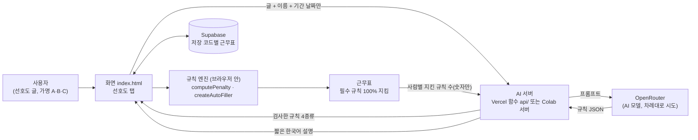

# 교대근무 근무표 작성기 + AI 선호도 반영 (timetable-ai)

[](https://github.com/sejoor12345-commits/timetable-ai/actions/workflows/ci.yml)

5조 2교대(인원에 따라 4·3조) 근무표를 규칙에 맞게 자동으로 짜 주는 브라우저 앱입니다.
사람마다 "주말엔 주간이 좋다", "주 비 주 비 주 야 비 흐름이 좋다" 같은 바람을 **말하듯이 쓰면**,
AI가 그 글을 규칙으로 바꾸고 근무표 엔진이 그 규칙을 되도록 지키며 근무표를 만듭니다.

> 실제 사용 전 확인할 것: [실사용 확인 체크리스트](#실사용-확인-체크리스트) (휴대폰에서 체크할 수 있는 페이지: `checklist.html`)

---

## 1. 문제

- 매일 주간 1명·야간 1명을 빈틈없이 채워야 하고, 야간 다음 날 주간·야간 연속(야야) 같은 금지 패턴을 피해야 합니다.
- 한 주 40시간을 넘겨야 위로휴가 1개가 생기는데, 5명이면 필요한 시간이 조건과 거의 딱 맞아 여유가 없습니다.
- 여기에 휴가·외출·신병 견습, 그리고 **사람마다 다른 바람**까지 따지면 손으로 짜기 어렵습니다.
- 그렇다고 AI(대형 언어 모델)에게 근무표를 통째로 맡기면, 28~35일 칸을 채우다 금지 패턴을 어기고
  위로휴가 시간을 잘못 세는 일이 자주 생깁니다.

## 2. 해결: AI는 "글 읽기"만, 근무표는 규칙 엔진이

AI가 잘하는 일(자유로운 글 읽기)과 프로그램이 잘하는 일(규칙을 정확히 지키며 찾기)을 나눴습니다.

1. 사용자가 선호도를 글로 씁니다. (예: `A는 주말에는 주간이 좋대요.`)
2. AI는 그 글을 **정해진 4종류의 규칙**으로만 바꿉니다 — 요일 규칙, 근무 흐름, 날짜 규칙, 주야 비율.
   못 바꾼 문장은 이유와 함께 따로 보여 줍니다.
3. 서버가 AI 답을 한 번 더 검사합니다(없는 이름, 기간 밖 날짜, 지킬 수 없는 흐름은 걸러 냄).
4. 화면(`index.html`)의 **규칙 엔진**이 그 규칙을 "벌점"으로 바꿔 근무표를 찾습니다.
   선호도는 인원 공백·필수 조건·위로휴가 목표·근무 개수·야야보다 **항상 뒤**입니다. 선호도 때문에 필수 규칙을 어기지 않습니다.

### 하이브리드 AI 구조



- **AI는 근무표를 만들지도, 받지도 않습니다.** 서버 함수에는 근무표를 넣는 입구가 없습니다.
- AI 서버는 두 곳 중 하나에서 돕니다. 둘 다 같은 프롬프트·같은 검사를 씁니다(자동 테스트로 글자까지 같은지 비교).
  - **Vercel 함수** (`api/`): Vercel 주소에서 바로. 이번에 추가됨.
  - **Colab 서버** (`timetable_server/`): Google Colab에서 켜는 예전 방식. 그대로 동작.
- 모델은 환경 변수 `OPENROUTER_MODELS`의 순서대로 시도합니다. 앞 모델이 없어졌거나(404), 막혔거나(429·5xx),
  답이 규칙 모양이 아니면 다음 모델로 넘어갑니다.

## 3. 개인정보

- **실명·계급·부대 이름 대신 A, B, C 같은 가명을 써 주세요.** 화면도 계급·부대 이름처럼 보이는 말을 찾으면 경고합니다.
- AI(OpenRouter)로 가는 것: **선호도 글, 인원 이름(가명), 기간 날짜·공휴일**. 결과 설명을 누르면 사람별 "지킨 규칙 수" 같은 숫자.
- AI로 가지 않는 것: 근무표 칸, 휴가 일정, 저장 코드, 접근 코드.
- 서버 로그에는 주소·상태 코드·걸린 시간·쓴 모델 이름만 남습니다. 선호도 글과 API 키는 남기지 않습니다.
- API 키는 Vercel 환경 변수(또는 Colab 보안 비밀)에만 있고 브라우저로 가지 않습니다.
- 근무표는 Supabase에 "저장 코드"별로 저장됩니다. 저장 코드를 아는 사람만 그 근무표를 열 수 있습니다.

## 4. 사용법

1. Vercel 주소(또는 `index.html` 파일)를 엽니다.
2. **설정** 탭: 기간 시작일(월요일)·4주/5주, 인원(가명)을 넣습니다.
3. **일정** 탭: 휴가·외출·신병 전입 같은 정해진 일정을 넣습니다.
4. **선호도** 탭: (처음 한 번) 접근 코드를 넣고 → 바람을 글로 쓰고 → **[AI로 해석하기]** → 규칙을 확인·조정(켜기/끄기, 강도).
5. **근무표** 탭: **[자동 생성]** 또는 **[다시 생성]** → 아래 "선호도 반영 결과"에서 사람별로 지킨 규칙을 확인 →
   필요하면 **[AI로 결과 설명 듣기]**.
6. 파일로 열면(더블클릭) AI 버튼만 막히고, 저장된 규칙은 그대로 자동 생성에 반영됩니다.

## 5. Vercel에 AI 켜기 (브라우저만으로)

Vercel은 이 저장소를 그대로 사이트로 보여 주고, `api/` 폴더의 파일은 자동으로 "서버 함수"가 됩니다.
따로 설치하거나 명령을 칠 필요는 없습니다. **환경 변수**(서버만 볼 수 있는 비밀 설정값) 3개만 넣으면 됩니다.

### 5-1. OpenRouter API 키 만들기 (사용 한도 꼭 걸기)

1. [openrouter.ai](https://openrouter.ai)에 로그인 → 오른쪽 위 프로필 메뉴 → **Keys**.
2. **Create Key** → 이름(예: `timetable-vercel`) 입력.
   **Credit limit(사용 한도)** 칸에 작은 금액(예: `1` 달러)을 넣으세요. 키가 새어도 그 이상은 못 씁니다.
3. 만들어진 키(`sk-or-…`)를 복사합니다. 이 화면을 닫으면 다시 볼 수 없으니 바로 다음 단계에 붙여 넣으세요.
4. 쓴 금액은 openrouter.ai의 **Activity** 화면에서 볼 수 있습니다.

### 5-2. Vercel 환경 변수 3개 넣기

1. [vercel.com](https://vercel.com) 로그인 → 이 저장소로 만든 프로젝트(예: `timetable-ai`)를 누릅니다.
2. 위쪽 메뉴 **Settings** → 왼쪽 메뉴 **Environment Variables**.
3. 아래 표의 값을 하나씩 넣습니다. **Key** 칸에 이름, **Value** 칸에 값, Environments는 **Production**과 **Preview** 모두 체크 → **Save**.

| Key | Value (예시) | 설명 |
|---|---|---|
| `OPENROUTER_API_KEY` | `sk-or-v1-…` (5-1에서 복사한 키) | 필수. AI를 부르는 열쇠. 브라우저로는 절대 가지 않음 |
| `ACCESS_CODE` | 나만 아는 말 (예: `우리반-2580`, 8자 이상 추천) | 필수. 이 코드를 아는 사람만 AI를 쓸 수 있음. 없으면 AI가 잠김 |
| `OPENROUTER_MODELS` | `google/gemini-2.5-flash-lite,openrouter/free` | 선택. 쉼표로 나눈 모델 목록(앞부터 시도). 비우면 기본 목록 |

4. 위쪽 메뉴 **Deployments** → 맨 위(가장 최근) 배포의 오른쪽 **⋯** → **Redeploy** → **Redeploy**.
   (환경 변수는 새로 배포해야 적용됩니다.)
5. 배포가 끝나면(Ready) 사이트 주소를 열고 **선호도** 탭 → 접근 코드를 넣고 **[확인]** → "● AI 연결됨"이 보이면 끝.

**모델 고르기 참고 (2026-10-31 기준)**

- 기본 목록: `stealth/space-bunny-alpha` → `google/gemini-2.5-flash-lite` → `openrouter/free`.
  첫 번째는 Colab 서버와 같은 모델인데, **이날 OpenRouter 공개 모델 목록에서 보이지 않았습니다**(없어진 것으로 보임).
  그래서 실제로는 두 번째 모델이 답하는 경우가 많고, 화면에 "첫 모델이 답하지 못해 … 모델로 해석했어요"라고 나옵니다.
- `google/gemini-2.5-flash-lite`는 아주 싼 유료 모델(해석 한 번에 1원도 안 되는 수준), `openrouter/free`는 무료 모델 중
  하나를 자동으로 골라 줍니다(무료라 느리거나 막힐 수 있음).
- 매번 없는 모델을 먼저 부르지 않게 하려면 `OPENROUTER_MODELS`에 위 표의 예시 값을 넣으세요.

**자주 생기는 문제**

| 화면에 보이는 것 | 할 일 |
|---|---|
| "AI 설정이 아직 안 됐어요" | 환경 변수 `OPENROUTER_API_KEY`·`ACCESS_CODE`를 넣고 Redeploy |
| "접근 코드가 맞지 않아요" | `ACCESS_CODE` 값과 똑같이 넣기 (10번 틀리면 10분 잠김) |
| "요청이 너무 많아요" | 한 기기(IP)에서 10분에 15번까지. 잠시 뒤 다시 |
| "AI 모델(…)을 찾을 수 없어요" | `OPENROUTER_MODELS`의 모델 이름 확인 ([모델 목록](https://openrouter.ai/models)) |
| "크레딧이 부족해서…" | openrouter.ai **Credits**에서 충전, 또는 무료 모델(`openrouter/free`)만 쓰기 |

> Vercel 무료 요금제에 맞춰 AI 함수는 최대 60초만 돌고, AI는 55초 안에 답해야 합니다(여러 모델을 합쳐서).

### 5-3. Colab에서 쓰기 (예전 방식, 그대로 동작)

`PRD_step1.md` 8장의 셀 1~4를 실행합니다. Colab에서는 접근 코드 칸이 나오지 않습니다.

## 6. 테스트와 자동 검사(CI)

- **자동 검사(CI)**: 코드를 올리거나 PR을 만들면 GitHub이 테스트를 대신 돌립니다. 위의 CI 배지나
  저장소의 **Actions** 탭에서 ✓(통과)/✕(실패)를 볼 수 있습니다. 진짜 AI·DB는 부르지 않습니다(가짜로 시험).
  - `npm test`: 계산 엔진 `runTests()` 224개(`tests/run-engine-tests.mjs`) + Vercel 함수 27개(`tests/api.test.mjs`)
  - `python -m pytest tests/`: Colab 서버 32개(`tests/test_timetable_server.py`)
  - `node tests/e2e-smoke.mjs`: 휴대폰 크기(390×844) 화면에서 접근 코드 → AI 해석 → 자동 생성 → 결과 설명까지 눌러 봄
- `tests/parity.py`: 같은 입력을 Python(Colab)과 JavaScript(Vercel)에 넣어 프롬프트·검사 결과가 **글자까지 같은지** 비교합니다.
- 브라우저에서 직접: 사이트를 열고 개발자 도구(F12) → Console에 `runTests()`.

## 실사용 확인 체크리스트

휴대폰에서 체크하려면 사이트 주소 뒤에 **`/checklist.html`** 을 붙여 여세요(체크한 것은 그 기기에 저장됨).
가짜 AI로는 이미 확인했지만, **진짜 AI의 품질·속도**는 직접 봐야 합니다. 예시 글은 아래를 그대로 쓰세요
(인원 A~E, 기간 2026-09-28(월)부터 4주).

```
A는 주말에는 주간이 좋대요.
B는 주 비 주 비 주 야 비 흐름을 좋아해요.
C는 10/3에는 꼭 쉬고 싶어요.
D는 야간 위주로 서고 싶어요.
E는 월요일 야간은 가능하면 피하고 싶대요.
F는 평일 주간만 원해요.
```

- [ ] 환경 변수 3개를 넣고 Redeploy한 뒤, 선호도 탭에 "접근 코드를 넣어 주세요"가 보인다.
- [ ] 접근 코드를 넣고 [확인]을 누르면 "● AI 연결됨 · 모델 …"이 보인다. 틀린 코드는 "맞지 않아요"가 뜬다.
- [ ] 예시 글로 [AI로 해석하기] → 지난 시간(초)이 보이고, 1분 안에 A~E 규칙 5개 + "바꾸지 못한 문장"(F) 1개가 나온다.
- [ ] B는 "근무 흐름: 주 비 주 비 주 야 비", C는 "10/3 근무 피하기 · 강함"이고, 규칙마다 원문 인용이 보인다.
- [ ] 규칙을 끄고 켜고, 강도를 바꾸고, 지울 수 있다. 바꾸면 근무표 탭의 총 벌점이 바로 바뀐다.
- [ ] [다시 생성] 후 요약 표 "선호도" 열과 "선호도 반영 결과"가 보이고, A의 주말 야간이 0~1번이다.
- [ ] 선호도를 켜고 만들어도(5명·4주·일정 없음) 위로휴가 "모두 달성", 빈 주·야 칸 0칸, 야야 0번이다.
- [ ] [AI로 결과 설명 듣기] → 3~6문장 한국어 설명. 목록에 없는 사람·날짜를 지어내지 않는다.
- [ ] 휴대폰 폭에서 선호도 탭과 결과가 가로 스크롤 없이 읽힌다.
- [ ] [백업 코드 복사] → 새로 고침 → [복원]으로 선호도 글과 규칙(켜기/끄기·강도 포함)이 그대로 돌아온다.
- [ ] openrouter.ai **Activity**에서 쓴 금액이 보이고, 키에 사용 한도(Credit limit)가 걸려 있다.
- [ ] Colab에서도(셀 1~4) 예전처럼 AI가 된다. (Colab은 접근 코드 없이)
- [ ] GitHub PR 아래 자동 검사 3개(Node·Python·화면)가 모두 ✓이다.

## 7. 로드맵

- [x] 1단계: AI 선호도 해석 + 규칙 엔진 반영 (`PRD_step1.md`)
- [x] 클라우드 저장(Supabase, 저장 코드)
- [x] Vercel에서 AI 사용 (서버 함수 + 접근 코드 + 요청 횟수 제한 + 모델 차례 시도), 자동 검사(CI)
- [ ] 진짜 AI로 체크리스트 확인 (사용자)
- [ ] 아직 정하지 않은 아이디어: 더 길고 좋은 탐색, "[다시 생성]을 더 누르면 나아질 수 있어요" 안내,
      "예시 글 넣기" 버튼, 두 사람 사이 조건(같이/따로 서기)·연속 근무 일수 규칙
- [ ] 요청 횟수 제한을 여러 서버가 함께 세도록(지금은 함수 하나 안에서만 셈) — 쓰는 사람이 늘면

## 파일 구조

```
index.html               화면 + 계산 로직 + runTests() (한 파일. 더블클릭으로도 열림)
checklist.html           실사용 확인 체크리스트 (휴대폰용)
api/                     Vercel 서버 함수: health.js · preferences.js · summary.js
api/_lib/                함께 쓰는 코드: openrouter.js(AI 부르기) · preferences.js(프롬프트·검사) · http.js(입력 검사·접근 코드·횟수 제한)
timetable_server/        Colab 서버 (Python): server.py · preferences.py · openrouter_client.py
supabase/rosters.sql     클라우드 저장 표·함수
tests/                   자동 테스트 (위 6장)
.github/workflows/ci.yml 자동 검사(CI) 설정
PRD.md, PRD_step1.md     규칙과 기능 문서
```

---

## English summary

**timetable-ai** is a single-file browser app that builds military shift rosters (2-shift, 3–5 people, 4–5 week periods)
under hard rules (coverage, no night→day, no double nights, weekly-hours leave targets). People's free-text preferences
are turned into a **closed set of 4 structured rule types** by an LLM (via OpenRouter); the in-browser **rule engine**
then searches for the roster, scoring preferences strictly below all hard constraints. The LLM never sees or builds
the roster — only the preference text, pseudonymous names and period dates are sent.

The AI endpoint runs either as **Vercel serverless functions** (`api/`, Node, no dependencies; env vars
`OPENROUTER_API_KEY`, `ACCESS_CODE`, optional `OPENROUTER_MODELS` fallback chain; per-IP in-memory rate limit;
no preference text in logs) or as the original **Colab Python server** (`timetable_server/`). A parity test
(`tests/parity.py` + `tests/api.test.mjs`) checks both produce identical prompts and validation results.
CI runs the engine's 224 built-in tests in Node, API handler tests with a mocked OpenRouter, pytest for the Python
server, and a Playwright phone-size end-to-end smoke test. Data is saved to Supabase via SECURITY DEFINER RPCs keyed by a
random save code.
